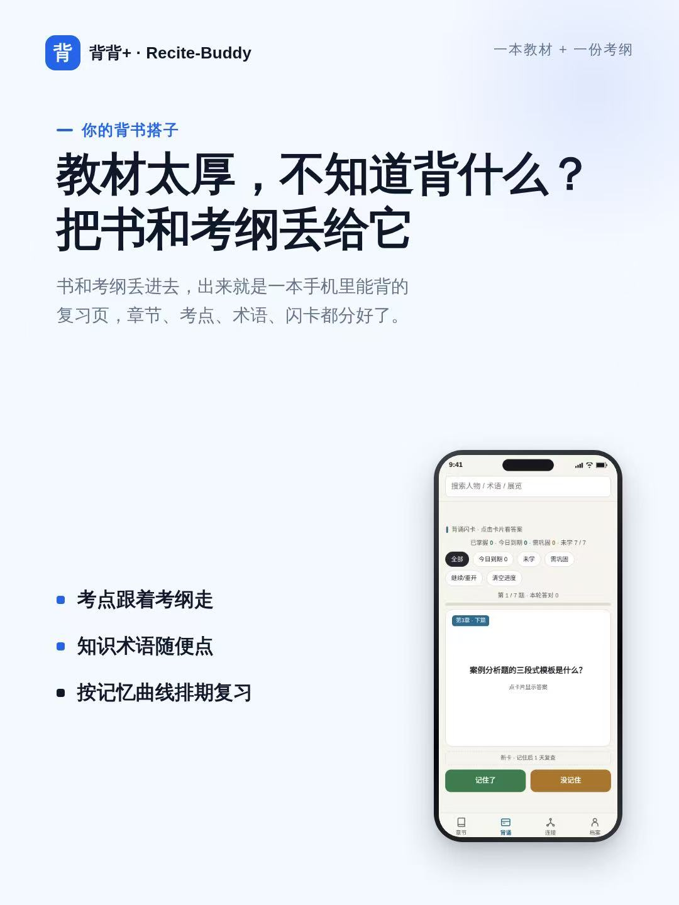
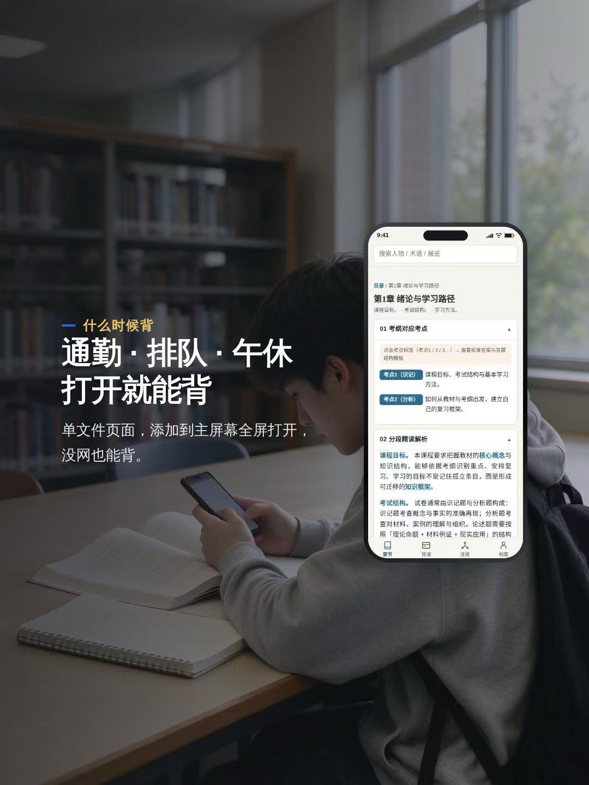
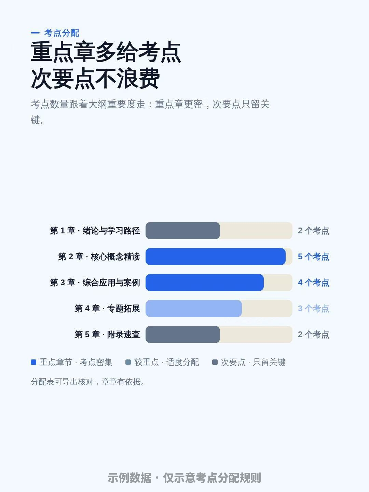

# 背背+skill（Recite-Buddy）

**版本 V1.2.8 ｜ 作者：K5LY ｜ GitHub：https://github.com/K5LY/Recite-Buddy ｜ 开源许可：MIT**

> 你的背背+skill · 根据考点带你背 · 应试背书

<p align="center">
  
</p>

## 这是什么

背背+skill（Recite-Buddy）是一款把「一本教材 + 一份考试大纲」变成「手机里能背的复习网页」的 AI 技能。

把书和大纲丢给它，它按章节帮你拆考点、写精读、标易错点，最后生成一个能点、能背、能存进度的单文件 HTML。手机添加到主屏幕就能当 App 用，离线也能背。

## 它给谁用

学生、备考者、自学者、考研考公考证人群。凡是「要啃一本书 + 要对着考纲复习」的人。

## 安装方法

对 agent 说一句"帮我安装这个 skill：<https://github.com/K5LY/Recite-Buddy>"，或者直接运行：

```bash
npx skills add K5LY/Recite-Buddy
```

## 怎么用

把**教材**和**考试大纲**发给 agent，说一句「依据这份大纲，把这本书做成背诵助手」，自动生成 HTML 并交付链接。不必特意说出品牌名「背背+skill」，任何描述"把书和考纲做成能背的复习页"的自然说法都能触发。

没有考纲也行，会自动进入无考纲模式（考点由教材自拟，页面有标注）。

上传的教材如果是**文言文 / 古文**，会先问你一句：要白话解读帮助理解，还是保留原文背诵？选白话解读，精读、考点、闪卡都会用大白话讲清文义再背；选原文背诵则维持原文表述。

> **生成要多久？** 视教材篇幅、考纲复杂度、图片识别量、模型处理与网络速度而定，可能从几分钟到更久，属正常现象。等待期间无需重复发送指令，生成完成会自动交付链接。

<p align="center">
  
</p>

## 能做什么

- **考纲考点对齐**：每章先列出考点，点开看标准答案和答题结构模板
- **考点动态分配**：重点章考点多、次要点少（可为 0），考点分配规则与每章考点数在页面内可展开核对

    
- **分章精读**：核心概念、关键术语、易错点、备考要点，每章末尾有知识总结表
- **知识内链**：正文人名、术语、展览随便点，档案里还能再跳，一键返回原位置
- **背诵闪卡**：翻卡自测，先自己答再翻答案。记住了的卡隔几天再回来考你，没记住的明天就再出现——像背单词软件那样，按你的记忆情况自动安排复习节奏。今日到期的卡自动排最前，进度存本地刷新不丢，背到一半退出重进不串题（题序与答对数保留），可回看上一题
- **文言文白话解读（可选）**：文言文书生成前会询问偏好——白话解读为主（推荐）/ 保留原文背诵 / 白话+原文对照；白话解读下精读、考点、闪卡全部用易懂的白话讲清文义再背
- **生僻字注音**：只为背诵服务，常用字不标，外文名标书里出现的外文原名
- **插图档案**：教材自带的图进档案，有就放，没有不放；网络补充图默认关闭，**不建议开启**；图片只取教材原图，或（需显式开启）开放许可来源的既有图片，**禁止 AI 生成图片**
- **主屏适配**：iPhone 添加到主屏幕，汉字图标、全屏打开、无留白

## 输入要求

| 材料 | 支持格式 |
|---|---|
| 教材 | PDF / HTML / Word / 纯文本 / 图片（拍照、截图）/ 表格 |
| 考试大纲 | 同上（拍照、截图也支持） |
| 无考纲 | 自动进入无考纲模式，考点由教材自拟 |

## 免责声明

- **内容准确性**：页面内容由 AI 依据你提供的教材与考纲生成，可能存在理解偏差、错漏或过时信息，仅供复习参考，不构成任何学业、考试结果或成绩的保证；关键事实请以原书、官方考纲及权威渠道为准。
- **文言文白话解读**：若教材为文言文并选用白话解读，页面白话内容为 AI 对原文的理解与转述，非逐字翻译，可能存在偏差；背诵与理解请以原文及权威注释为准。
- **图片与 OCR**：若教材或考纲以图片形式提供（拍照、截图），页面文字依赖 OCR 识别与模型理解，识别可能不准，图片裁切可能不完美，请以原书为准。
- **版权归属**：教材、考纲及其内容的著作权归原权利人所有；本技能仅提供排版、交互与生成能力，产物不含教材原文的分发。使用者以自有材料生成的内容，由使用者自行负责。
- **使用者责任**：你（使用者）自行负责所提供材料的合法性、以及使用产物产生的一切后果；不得将产物用于任何违反法律法规或侵犯第三方权益的用途；本技能与产物不替代官方教材、考纲及权威信息源，不构成任何学术诚信、考试规范或第三方义务的背书。
- **许可与担保**：本项目按 MIT 许可开源，按「现状」提供，不附带任何明示或默示担保，作者不对因使用本技能或产物造成的任何直接或间接损失承担责任。

### 关于网络补充图

本技能默认只使用教材自带的插图。若在生成时提出补充图片的需求，页面可补充少量来自开放许可来源（如博物馆、图书馆、档案馆的开放数据）的图片，并在图注中标注出处与许可。

**不建议开启此选项。** 网络图片无法保证与原书的表述、版本、图注完全一致，用于备考存在记错的风险；教材原图与考纲原文才是唯一可靠依据。若仍要开启，请逐张核对出处与许可，并自行承担准确性责任。

本技能不使用 AI 生成的图片：所有图片要么来自教材，要么来自可核对的开放许可来源。

## 产出物

- 单文件 HTML（打开即用，无需联网）
- 可访问链接（手机 / 电脑都能打开）
- 可选：主屏汉字图标

## 换下一本书

数据、模板、脚本全部通用，换书只换输入。每本书的背诵进度独立保存，互不干扰。

## 字体说明

页面仅引用设备已装系统字体（PingFang SC / Noto Sans SC / Microsoft YaHei 等），不加载、不嵌入字体文件；主屏图标由本机已装字体渲染字形，字体文件不进入产物、不随项目分发。项目点名的开源字体 Noto Sans/Serif CJK（思源黑体/宋体）采用 SIL Open Font License 1.1，可自由使用与再分发。

## 文件结构

```
recite-buddy/
├── SKILL.md          # 技能规范：执行流程与数据格式
├── README.md         # 项目说明
├── LICENSE           # MIT 开源许可
└── assets/
    ├── template.html # 通用 HTML 模板（样式/交互/布局，无需修改）
    ├── build.py      # 组装脚本：数据 + 配置，生成最终 HTML（含自动校验）
    ├── make_icon.py  # 生成主屏汉字图标
    └── images/       # README 配图（hero / 使用场景 / 考点分配示意）
```

## 常见问题

**Q：没有考试大纲怎么办？**
照常生成。进入无考纲模式，考点由教材自拟并明确标注；拿到考纲后可重新提供重建。

**Q：生成的页面需要联网吗？**
不需要。产物为单文件自包含 HTML。

**Q：注音标准是什么？**
常用字不标注；外文名标注书中出现的外文原名（书中没有就不标，不自行补充）；中文专名只标不常见读音。

**Q：生成要等多久？**
受教材篇幅、考纲复杂度、图片识别量、模型处理与网络速度影响，长短不一。简单的小册子可能几分钟，大部头或图片较多的书会更久；生成期间无需重复发送指令。

## 更新日志

**V1.2.8**：桌面端导航胶囊化、本章档案补齐术语入口、易错/备考分区编号展示，以及背诵进度防串题等交互体验优化。

## 许可

MIT License（见 LICENSE 文件），Copyright (c) 2026 K5LY。
